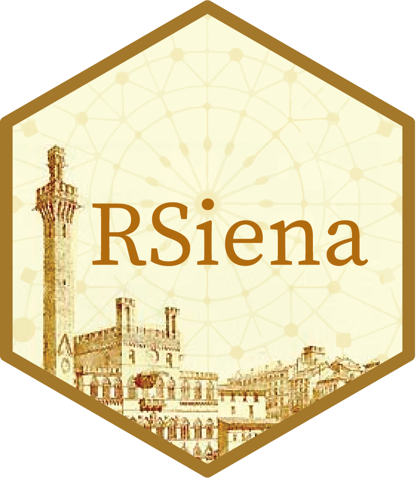

<!-- README.md is generated from README.Rmd. Please edit that file. -->

```{r, include = FALSE}
knitr::opts_chunk$set(
  collapse = TRUE,
  comment = "#>"
)
```

# RSiena 

<!-- badges: start -->
[](https://cran.r-project.org/package=RSiena)
[](https://github.com/stocnet/rsiena/releases/latest)
[](https://github.com/stocnet/rsiena/actions/workflows/pushrelease.yml)
[](https://cran.r-project.org/package=RSiena)
[](https://lifecycle.r-lib.org/articles/stages.html#stable)
[](https://github.com/stocnet/rsiena/releases)
<!-- badges: end -->

SIENA is a program for the statistical analysis of longitudinal network data, with the focus on social networks.
Networks here are understood as entire (complete) networks, not as personal (egocentered) networks:
it is assumed that a set of nodes (social actors) is given, and all ties (links) between these nodes are known -
except perhaps for a moderate amount of missing data.
`Longitudinal` means that two or more repeated observations ("panel data") are available.
The name SIENA stands for Simulation Investigation for Empirical Network Analysis.
The R package is called RSiena.

The main model in SIENA is the Stochastic Actor-oriented Model (SAOM).
In this model, the actors who are the nodes of the network change their ties
(and, if included, their behaviour) step by step between the observations.
The model represents network dynamics as the result of many tendencies that operate at the same time,
such as reciprocity, transitivity ("friends of my friends are my friends"),
homophily (ties between actors who are similar), and the effects of actor and dyadic covariates.
SIENA estimates the strength of each tendency and tests hypotheses about it,
while it controls for the other tendencies.
With networks and behaviour together, SIENA can separate *selection*
(actors choose ties to similar others) from *influence*
(actors become more similar to the others they have ties to).

- [Data types](#data-types)
- [Example](#example)
- [Documentation and help](#documentation-and-help)
- [Installation](#installation)
- [Citation](#citation)
- [About the project](#about-the-project)

## Data types

SIENA is designed for analyzing various types of data as dependent variables:

### Longitudinal network data

This refers to repeated measures of networks on a given node set (although it is allowed that there are some changes in the node set).
Networks can be one-mode directed, one-mode non-directed, or two-mode (directed from the first to the second mode).
The main model is the actor-oriented SAOM;
for non-directed networks, tie-oriented models are also available.

All models in SIENA are Markov chain models.
They are best suited to ties and behaviour that can be regarded as *states*
(for example friendship or advice), and less to *events* that do not endure
(for example messages or meetings).
For data on events, see the [goldfish](https://stocnet.github.io/goldfish/) package.

The analysis is based on simulation of the network, and this can take time.
The method is applicable in principle to networks of approximately 10 to 1,000 actors;
in practice, a few hundred actors is already large.
For many replications of small networks (from about 5 to 60 actors),
the multilevel option `sienaBayes` is available in the sister package `multiSiena`.

### Longitudinal data of networks and behavior

This is like longitudinal network data, but in addition there are one or more changing nodal variables that are also treated as dependent variables, and referred to as behavior. The network will influence the dynamics of the behavior, and the behavior will influence the dynamics of the network. In other words, this is about the co-evolution of networks and behavior.

### Multivariate and two-mode networks

Network data sets can be multivariate, i.e., be composed of multiple networks on the same node set.
Some or all of these networks can be two-mode networks. The restriction is that the first mode must be the same for all networks; the first mode is defined as the set of actors. The second mode node sets are allowed to differ across the various networks in a given data set. For such multivariate data sets, the model again is about the co-evolution of several networks; and this may be combined with behavior.

## Example

This example uses the `s50` data that come with the package:
friendship networks among 50 pupils at three time points, and their alcohol use.
The model asks two questions at the same time.
Do pupils select friends who drink like them (selection)?
Do pupils change their drinking to be more like their friends (influence)?

```{r example, message = FALSE}
library(RSiena)

# 1. Make the data: two dependent variables that change together
friends  <- as_dependent_rsiena(array(c(s501, s502, s503), dim = c(50, 50, 3)))
drinking <- as_dependent_rsiena(s50a, type = "behavior")
mydata   <- make_data_rsiena(friends, drinking)

# 2. Specify the model: start from the defaults, then add effects
myeff <- make_specification(mydata)
# network closure
myeff <- set_effect(myeff, list(transTrip, cycle3), verbose = FALSE)
# selection: drinking of ego and alter, and similarity in drinking
myeff <- set_effect(myeff, list(egoX, altX, simX), covar1 = "drinking",
                    verbose = FALSE)
# influence: drinking becomes more like the drinking of friends
myeff <- set_effect(myeff, avSim, covar1 = "friends", depvar = "drinking",
                    verbose = FALSE)

# 3. Estimate the model (about 10 seconds)
myalgo <- set_algorithm_saom(seed = 1234)
ans <- siena(mydata, effects = myeff, control_algo = myalgo, batch = TRUE)
ans
```

If all convergence t-ratios are below 0.1 and the overall maximum convergence
ratio is below 0.25, the estimation converged.
The estimates show whether pupils choose friends with similar drinking behaviour
(`drinking similarity`) and whether pupils adapt their drinking to their friends
(`drinking average similarity`).
To use your own data, replace the matrices in step 1 with your own adjacency
matrices (one per wave) and your own behaviour matrix (actors × waves).

## Documentation and help

- The [RSiena manual](https://github.com/stocnet/rsiena/releases/latest/download/RSiena_Manual.pdf)
  gives a full description of the models, effects and functions.
  It complements the help pages in the package.
  Each release includes the version of the manual for that release.
- The [package website](https://stocnet.github.io/rsiena/) has the help pages for all functions and the news for each release.
- The [RSiena scripts](https://www.stats.ox.ac.uk/~snijders/siena/siena_scripts.htm)
  show many types of analysis step by step.
  They are moving to the package website ([#4](https://github.com/stocnet/rsiena/issues/4)).
- For questions about the use of RSiena, join the
  [RSiena users' group at groups.io](https://groups.io/g/RSiena).
- To report a bug or ask for a new feature, open an
  [issue on GitHub](https://github.com/stocnet/rsiena/issues).
- [Instats](https://instats.org/seminar/longitudinal-social-network-analysis)
  offers an on-demand introductory workshop on the SAOM and RSiena, taught by Tom Snijders
  (18 recorded sessions of 45 minutes).
  Workshops are also given regularly at the Sunbelt conferences of INSNA.

### Introductory reading

- Snijders, T.A.B., van de Bunt, G.G., and Steglich, C.E.G. (2010).
  Introduction to stochastic actor-based models for network dynamics.
  *Social Networks*, 32, 44–60.
  <https://doi.org/10.1016/j.socnet.2009.02.004>.
  A tutorial introduction.
- Snijders, T.A.B. (2017). Stochastic actor-oriented models for network dynamics.
  *Annual Review of Statistics and Its Application*, 4, 343–363.
  <https://doi.org/10.1146/annurev-statistics-060116-054035>.
  An overview of the models.
- Steglich, C.E.G., Snijders, T.A.B., and Pearson, M. (2010).
  Dynamic networks and behavior: Separating selection from influence.
  *Sociological Methodology*, 40, 329–393.
  <https://doi.org/10.1111/j.1467-9531.2010.01225.x>.
  The model for the co-evolution of networks and behaviour.
- Snijders, T.A.B. (2024). [Siena algorithms](https://www.stats.ox.ac.uk/~snijders/siena/Siena_algorithms.pdf).
  A sketch of the main algorithms in RSiena, as background for the code.

## Installation

For most people, the best way to install RSiena is to install the latest version from CRAN:

```r
install.packages("RSiena")
```

The latest binary release on GitHub can have newer features than the CRAN version:

```r
# On Windows:
install.packages("https://github.com/stocnet/rsiena/releases/latest/download/RSiena.zip", repos = NULL)

# On Linux
install.packages("https://github.com/stocnet/rsiena/releases/latest/download/RSiena.tar.gz", repos = NULL)

# On Mac
install.packages("https://github.com/stocnet/rsiena/releases/latest/download/RSiena.tgz", repos = NULL)
```

To compile and install the source version from GitHub, install the `{remotes}` package and then run the following.
This needs a compiler for `C++` source files, and it can take some time.

```r
# latest version
remotes::install_github("stocnet/rsiena@main")

# development version
remotes::install_github("stocnet/rsiena@develop")
```

## Citation

To cite RSiena in publications, use the references that `citation("RSiena")` gives
for the version that you used:

```{r citation}
citation("RSiena")
```

Please also cite the methods that you use.
The manual and the help pages give the relevant references.

## About the project

SIENA is part of an ongoing research effort.
The research team is composed of Tom Snijders, Christian Steglich, Johan Koskinen,
Nynke Niezink, Viviana Amati, Daniel Gotthardt, Christoph Stadtfeld, Robert Krause,
and James Hollway, with earlier contributions from Ruth Ripley, Krists Boitmanis,
Felix Schönenberger, Charlotte Greenan, Josh Lospinoso, Paulina Preciado,
Michael Schweinberger, Mark Huisman, and Marijtje van Duijn.
RSiena was originally programmed by Ruth Ripley and Krists Boitmanis,
in collaboration with Tom Snijders.
Christian Steglich is the maintainer of the package.

RSiena received the 2017 INSNA William D. Richards Award,
a lifetime achievement award for publicly available social network analysis software.

### Funding

We are grateful to NIH (National Institutes of Health, USA)
for their funding of programming RSiena during 2008-2014,
as part of the project *Adolescent Peer Social Network Dynamics and Problem Behavior*
(Grant Number 1R01HD052887-01A2),
Principal Investigator John M. Light (Oregon Research Institute).

For earlier work on SIENA, we are grateful to NWO (Netherlands Organisation for
Scientific Research) for their support to the projects
*Models for the Evolution of Networks and Behavior* (461-05-690),
*The dynamics of networks and behavior* (401-01-550),
*Statistical methods for the joint development of individual behavior and peer networks* (575-28-012), and
*An open software system for the statistical analysis of social networks* (405-20-20),
and to the foundation ProGAMMA.
